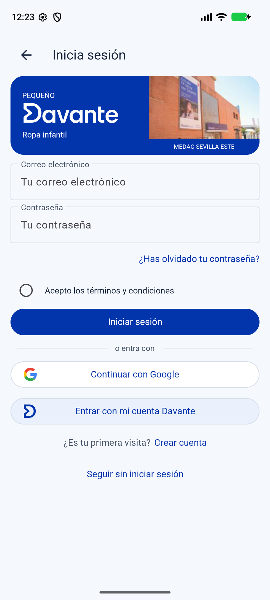

# Pequeño Davante

Marta González González - Desarrollo de Interfaces - 2.º DAM

Proyecto de la pantalla de inicio de sesión de Pequeño Davante para la actividad "Del prototipo al código (I) - Figma a Android Studio"

Incluye los recursos del diseño y la pantalla hecha con Java y vistas XML, con la marca, la fotografía del centro, los campos y las opciones de acceso

## Memoria y Figma

- [Memoria de la actividad en PDF](docs/gonz%C3%A1lez_marta_figma_android.pdf)
- [Copia de desarrollo en Figma](https://www.figma.com/design/EsUftS945DYUInVenDYTTj?node-id=46-723)

## Configuración del proyecto

- Java y vistas XML
- SDK mínimo API 28, compilación API 36.1 y objetivo API 36
- "ViewBinding" activado
- Actividad "InicioSesionActivity" y layout "activity_inicio_sesion.xml"
- Tema claro "Theme.Material3.Light.NoActionBar"

## Recursos

Los colores, textos, estilos, tema y medidas están en "res/values", las fuentes Roboto Regular y Medium están incluidas en "res/font"

Los iconos y logotipos están en "res/drawable" como vectores, junto con los fondos de los controles, la fotografía del centro está en "res/drawable-xxhdpi" como WebP

La licencia de Roboto está en ["LICENCIA-Roboto.txt"](LICENCIA-Roboto.txt)

## Abrir y ejecutar

1. Clona o descarga el repositorio y abre su carpeta raíz en Android Studio
2. Sincroniza Gradle con el JDK incluido en Android Studio e instala el SDK 36.1 si lo solicita
3. Selecciona un emulador o móvil con API 28 o superior y ejecuta la configuración "app"

Los campos permiten escribir, la contraseña queda oculta y la casilla de términos se puede marcar y desmarcar, la pantalla permite desplazarse cuando aparece el teclado, los botones de acceso no están conectados a un servicio de autenticación

Las carpetas de compilación y la configuración local del SDK están excluidas del repositorio

## Pantalla

