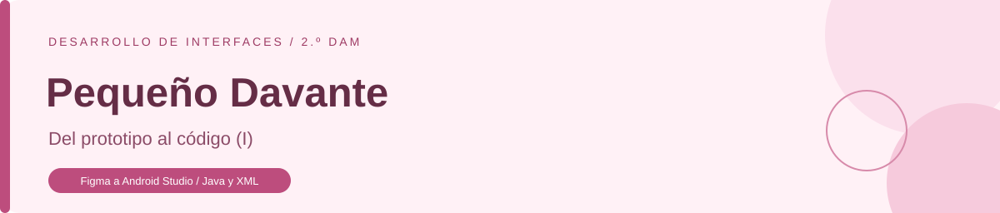

<p align="center">
  
</p>

<p align="center">
  <strong>Marta González González</strong><br>
  Desarrollo de Interfaces - 2.º DAM
</p>

<p align="center">
  <a href="docs/gonz%C3%A1lez_marta_figma_android.pdf">Memoria de la actividad en PDF</a>
  &nbsp; | &nbsp;
  <a href="https://www.figma.com/design/EsUftS945DYUInVenDYTTj?node-id=46-723">Copia de desarrollo en Figma</a>
</p>

## Sobre el proyecto

Este trabajo parte de la pantalla de inicio de sesión de Pequeño Davante, una aplicación de ropa infantil diseñada en Figma, y corresponde a la actividad "Del prototipo al código (I) - Figma a Android Studio"

El proyecto reúne los recursos preparados a partir del diseño y la pantalla construida con Java y vistas XML, con la cabecera, la marca, la fotografía del centro y el formulario de acceso

Los campos permiten escribir el correo y la contraseña, la contraseña se muestra oculta y la casilla de términos se puede marcar y desmarcar, el contenido se desplaza cuando aparece el teclado o falta espacio en la pantalla

Los botones de acceso están representados en la interfaz, la actividad se centra en el diseño y la preparación del proyecto y no incorpora un servicio de autenticación

## Documentación y diseño

La [memoria en PDF](docs/gonz%C3%A1lez_marta_figma_android.pdf) incluye el análisis de bloques, el árbol de la pantalla, la correspondencia con las vistas Android, las tablas de especificaciones, el inventario de recursos, las capturas y la reflexión final

La [copia de desarrollo de Figma](https://www.figma.com/design/EsUftS945DYUInVenDYTTj?node-id=46-723) permite consultar las capas renombradas y las propiedades del frame "ly_inicio_sesion"

## Configuración

| Apartado | Valor |
| --- | --- |
| Lenguaje de la aplicación | Java |
| Interfaz | Vistas XML |
| SDK mínimo | API 28 |
| SDK de compilación | API 36.1 |
| SDK objetivo | API 36 |
| Versión de Java del código | 17 |
| Acceso a las vistas | "ViewBinding" |
| Actividad | "InicioSesionActivity" |
| Layout | "activity_inicio_sesion.xml" |
| Tema | "Theme.Material3.Light.NoActionBar" |

## Organización de los recursos

| Archivo o carpeta | Contenido |
| --- | --- |
| "app/src/main/java" | Actividad de la pantalla y acceso a las vistas mediante "ViewBinding" |
| "res/layout/activity_inicio_sesion.xml" | Estructura y distribución de los controles |
| "res/values/colors.xml" | Colores con nombres según su función |
| "res/values/strings.xml" | Textos y descripciones de los elementos, guardados en UTF-8 |
| "res/values/styles.xml" | Fuentes, tamaños, interlineados y estilos de los controles |
| "res/values/themes.xml" | Tema claro y colores generales de la aplicación |
| "res/values/dimens.xml" | Medidas, márgenes, separaciones y radios |
| "res/values/fractions.xml" | Proporción entre el bloque de marca y la fotografía |
| "res/font" | Roboto Regular 400 y Medium 500, incluidas en el proyecto |
| "res/color" | Colores de los bordes y las etiquetas según el estado del campo |
| "res/drawable" | Iconos y logotipos como "VectorDrawable", fondos y estados de la casilla |
| "res/drawable-xxhdpi" | Fotografía del centro en WebP de 438 × 360 px |
| "docs" | Memoria en PDF, portada del repositorio y captura de la pantalla |

La licencia de las fuentes se conserva en ["LICENCIA-Roboto.txt"](LICENCIA-Roboto.txt)

## Abrir y ejecutar

1. Clona o descarga este repositorio y abre su carpeta raíz en Android Studio
2. Utiliza el JDK incluido en Android Studio y deja que Gradle sincronice el proyecto
3. Instala el SDK de compilación 36.1 si Android Studio lo solicita y configura la ruta local del SDK
4. Selecciona un emulador o un móvil con Android 9, API 28, o una versión posterior
5. Ejecuta la configuración "app" para abrir la pantalla de inicio de sesión

También se puede compilar y revisar el proyecto desde la terminal de Android Studio en Windows

```text
.\gradlew.bat assembleDebug lintDebug
```

"local.properties", ".idea", ".gradle" y las carpetas "build" quedan fuera del repositorio, cada equipo mantiene su configuración local y genera sus archivos de compilación

## Pantalla en el emulador

<p align="center">
  
</p>

<p align="center"><em>Cabecera, marca y fotografía del centro, formulario y opciones de acceso</em></p>
